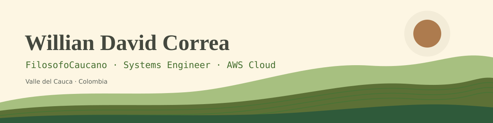

  

## About

Systems Engineer from Valle del Cauca, Colombia. I like building things that connect code to the physical world: sensors, data pipelines and the cloud services that hold them together.

- Moving toward **AWS cloud engineering**, with a long-term goal of remote work with international teams.
- Building a **soil telemetry node** (ESP32 → MQTT → vector database) aimed at agritech.
- Also certified in **LoRaWAN**, **UAS (drone) piloting** and **AutoCAD 3D**.
- Languages: Spanish (native), English (B2+), Portuguese.

## Featured projects

| Project | What it is |
|---|---|
| [**music-machine-learning-backend**](https://github.com/FilosofoCaucano/music-machine-learning-backend) | Machine-learning notebooks on instrument audio: bombo, bandola, charango and cajón. |
| [**camiones-del-sur**](https://github.com/FilosofoCaucano/camiones-del-sur) | Road-transport simulator in Python + ursina, with pure, testable game logic that runs without opening a window. |
| [**cenit**](https://github.com/FilosofoCaucano/cenit) | Finds the two dates each year when the sun crosses the zenith over any Colombian municipality. Python desktop app + Android app. |
| [**rackituq**](https://github.com/FilosofoCaucano/rackituq) | A programming language of my own, built in Racket. |
| [**fruta-tienda**](https://github.com/FilosofoCaucano/fruta-tienda) | Fruit shop built with Spring Boot and Angular. |

## Stack

  
  
  
  
  
  
  
  

## Contact

Open to remote cloud and IoT roles. The best way to reach me is LinkedIn.

